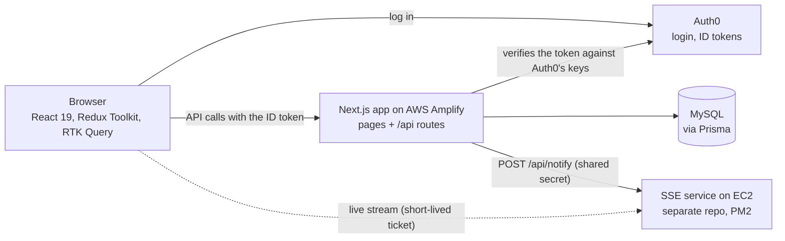
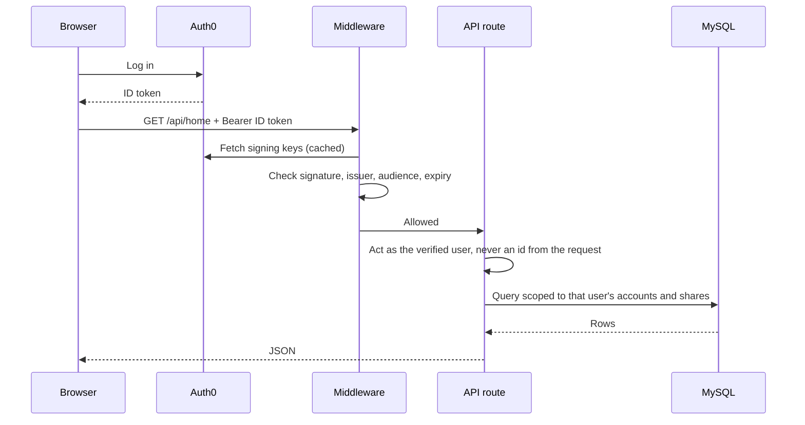
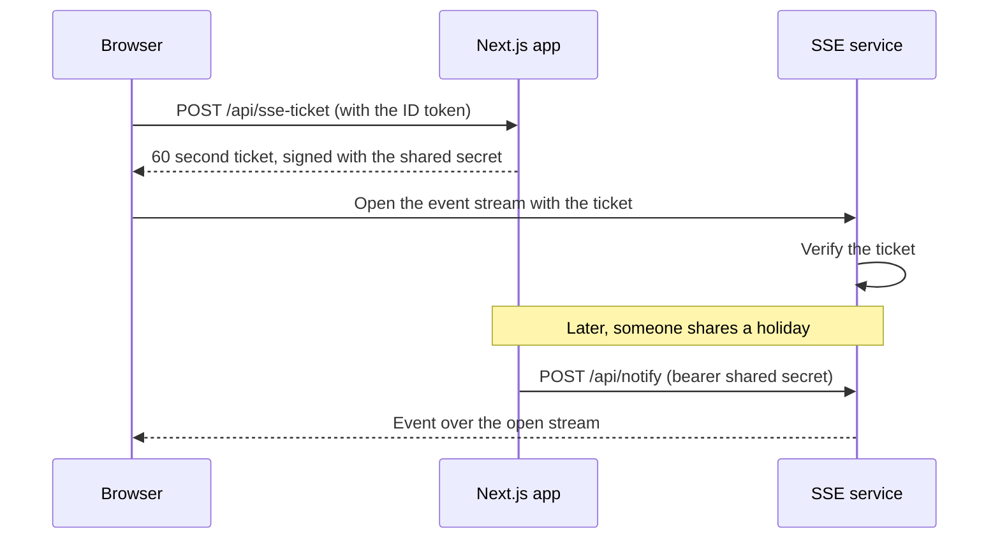
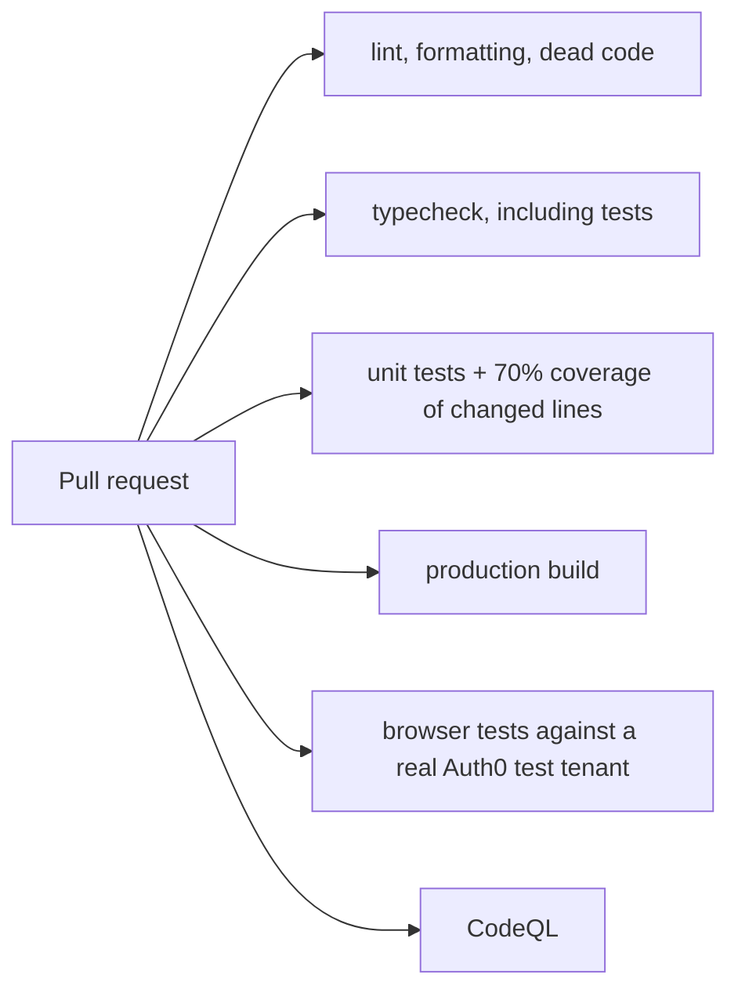

# Architecture

## The pieces

The notification service is its own project because Amplify's serverless runtime cannot hold long-lived connections open. See [sse-notifications](https://github.com/Lanny-MacMillan/sse-notifications).

## How a request is authenticated

- The client attaches the token in one place (`src/lib/authFetch.ts`), so components never handle it.
- `src/middleware.ts` rejects any `/api/*` request without a valid token, except the health check and the anonymous performance beacon, and rate limits per client.
- Routes read the user from the verified token (`authenticate()` in `src/lib/routeAuth.ts`). A user id sent in a body, query string or header is not trusted.
- Every route that touches a record checks the caller owns it or belongs to it (`assertHolidayAccess`, `src/lib/rbac.ts`) and looks the record up within that parent, not by its id alone.

## How a live notification gets to a browser

The stream URL never carries a user id: the ticket is the proof of who is listening, and it expires within a minute.

## How the data is loaded

`/api/home` returns everything a signed-in user needs in one request. A shared `loadHome` thunk (`src/store/loadHome.ts`) puts it in the `home` slice and pre-fills the RTK Query caches, so holiday pages render without further requests. It runs for any page, so a holiday page can be opened directly.

## How changes are checked

The browser tests sign in with a real token from an isolated Auth0 test connection, then add a gift, check one user cannot reach another's holiday, share a holiday and accept the invite, and open a holiday page directly.
